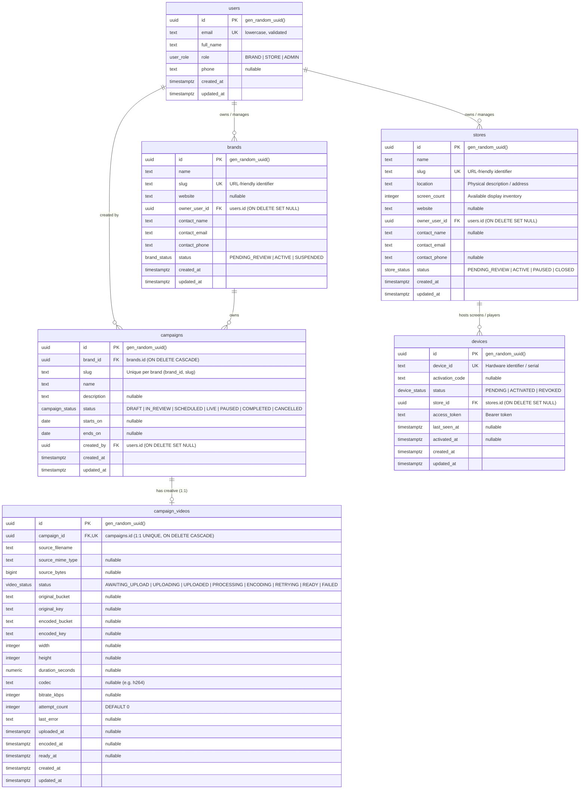

# Database Schema Documentation — String Theory

This document outlines the relational database schema for the **String Theory** advertising platform.

---

## 1. Entity-Relationship (ER) Diagram



---

## 2. Schema Architecture & Design Principles

- **PostgreSQL Core**: Uses `pgcrypto` (`gen_random_uuid()`) for non-enumerable primary keys and `timestamptz` across all tables.
- **Trigger-Driven `updated_at`**: Maintained automatically at the database level via the `st_set_updated_at()` trigger function.
- **Strict Database Invariants**: Extensive check constraints validate non-blank strings, lowercase emails, valid URL schemes, and logical date ranges (`ends_on >= starts_on`).
- **Referential Integrity**:
  - `brands.owner_user_id` / `stores.owner_user_id` / `campaigns.created_by`: Use `ON DELETE SET NULL` to preserve business and billing records if user accounts are removed.
  - `campaigns.brand_id` & `campaign_videos.campaign_id`: Use `ON DELETE CASCADE` to clean up associated campaign resources when a brand or campaign is deleted.

---

## 3. Tables & Enums Summary

| Table | Description | Primary Key | Foreign Keys / Relations |
| :--- | :--- | :--- | :--- |
| **`users`** | Authentication and RBAC identity (`BRAND`, `STORE`, `ADMIN`) | `id` (UUID) | None |
| **`brands`** | Brand customer accounts and business contacts | `id` (UUID) | `owner_user_id` &rarr; `users.id` |
| **`stores`** | Physical store display network venues and screen inventory | `id` (UUID) | `owner_user_id` &rarr; `users.id` |
| **`campaigns`** | Marketing campaigns scoped to brands with lifecycle states | `id` (UUID) | `brand_id` &rarr; `brands.id`, `created_by` &rarr; `users.id` |
| **`campaign_videos`** | 1:1 Creative video metadata, S3 keys, and transcoding pipeline states | `id` (UUID) | `campaign_id` &rarr; `campaigns.id` (1:1 UNIQUE) |
| **`devices`** | Raspberry Pi screen player hardware, activation status, and access tokens | `id` (UUID) | `store_id` &rarr; `stores.id` (ON DELETE SET NULL) |

### Custom Enums:
- `user_role`: `'BRAND'`, `'STORE'`, `'ADMIN'`
- `brand_status`: `'PENDING_REVIEW'`, `'ACTIVE'`, `'SUSPENDED'`
- `store_status`: `'PENDING_REVIEW'`, `'ACTIVE'`, `'PAUSED'`, `'CLOSED'`
- `campaign_status`: `'DRAFT'`, `'IN_REVIEW'`, `'SCHEDULED'`, `'LIVE'`, `'PAUSED'`, `'COMPLETED'`, `'CANCELLED'`
- `video_status`: `'AWAITING_UPLOAD'`, `'UPLOADING'`, `'UPLOADED'`, `'PROCESSING'`, `'ENCODING'`, `'RETRYING'`, `'READY'`, `'FAILED'`
- `device_status`: `'PENDING'`, `'ACTIVATED'`, `'REVOKED'`

---

## 4. Sample Records & Relational Visualization

The sample dataset below illustrates **2 representative records per table**, demonstrating how Primary Keys (`PK`) and Foreign Keys (`FK`) interconnect across the String Theory platform.

### 4.1 Relationship Instance Diagram

```mermaid
graph TD
    classDef user fill:#e1f5fe,stroke:#0288d1,stroke-width:2px;
    classDef brand fill:#e8f5e9,stroke:#388e3c,stroke-width:2px;
    classDef store fill:#fff3e0,stroke:#f57c00,stroke-width:2px;
    classDef campaign fill:#f3e5f5,stroke:#7b1fa2,stroke-width:2px;
    classDef video fill:#fce4ec,stroke:#c2185b,stroke-width:2px;

    subgraph Users ["users"]
        U1["<b>users[0] (Ada Okafor)</b><br/>id: 11111111-...0001<br/>role: BRAND"]:::user
        U2["<b>users[1] (Marcus Vance)</b><br/>id: 11111111-...0002<br/>role: STORE"]:::user
    end

    subgraph Brands ["brands"]
        B1["<b>brands[0] (Acme Athletics)</b><br/>id: 22222222-...0001<br/>owner_user_id: 11111111-...0001"]:::brand
        B2["<b>brands[1] (Lumina Optics)</b><br/>id: 22222222-...0002<br/>owner_user_id: 11111111-...0001"]:::brand
    end

    subgraph Stores ["stores"]
        S1["<b>stores[0] (Northside Coffee)</b><br/>id: 33333333-...0001<br/>owner_user_id: 11111111-...0002<br/>screens: 6"]:::store
        S2["<b>stores[1] (Riverside Gym)</b><br/>id: 33333333-...0002<br/>owner_user_id: NULL (Ops-managed)<br/>screens: 24"]:::store
    end

    subgraph Campaigns ["campaigns"]
        C1["<b>campaigns[0] (Spring Marathon)</b><br/>id: 44444444-...0001<br/>brand_id: 22222222-...0001<br/>created_by: 11111111-...0001<br/>status: LIVE"]:::campaign
        C2["<b>campaigns[1] (Summer Shades)</b><br/>id: 44444444-...0002<br/>brand_id: 22222222-...0002<br/>created_by: 11111111-...0001<br/>status: DRAFT"]:::campaign
    end

    subgraph CampaignVideos ["campaign_videos (1:1 with campaigns)"]
        V1["<b>campaign_videos[0]</b><br/>id: 55555555-...0001<br/>campaign_id: 44444444-...0001<br/>status: READY (1080p, H.264)"]:::video
        V2["<b>campaign_videos[1]</b><br/>id: 55555555-...0002<br/>campaign_id: 44444444-...0002<br/>status: AWAITING_UPLOAD"]:::video
    end

    U1 -->|owns / manages (1:N)| B1
    U1 -->|owns / manages (1:N)| B2
    U2 -->|owns / manages (1:N)| S1
    B1 -->|has campaign (1:N)| C1
    B2 -->|has campaign (1:N)| C2
    U1 -.->|created_by (audit FK)| C1
    U1 -.->|created_by (audit FK)| C2
    C1 ===|1:1 creative| V1
    C2 ===|1:1 creative| V2
```

---

### 4.2 Sample Records by Table

#### Table: `users`
| Field | Record 1 (`users[0]`) | Record 2 (`users[1]`) | Description / Relational Role |
| :--- | :--- | :--- | :--- |
| **`id`** *(PK)* | `11111111-1111-4000-8000-000000000001` | `11111111-1111-4000-8000-000000000002` | Database-generated UUID |
| **`email`** *(UK)* | `ada@stringtheory.test` | `cafe@stringtheory.test` | Normalized lowercase identity |
| **`full_name`** | `Ada Okafor` | `Marcus Vance` | User contact name |
| **`role`** | `BRAND` | `STORE` | Platform RBAC role (`BRAND`, `STORE`, `ADMIN`) |
| **`phone`** | `+44 20 7946 0001` | `+44 20 7946 0002` | Contact phone number |
| **`created_at`** | `2026-03-01 09:00:00+00` | `2026-03-02 10:15:00+00` | Registration timestamp |
| **`updated_at`** | `2026-03-01 09:00:00+00` | `2026-03-02 10:15:00+00` | Maintained via `st_set_updated_at()` trigger |

---

#### Table: `brands`
| Field | Record 1 (`brands[0]`) | Record 2 (`brands[1]`) | Description / Relational Role |
| :--- | :--- | :--- | :--- |
| **`id`** *(PK)* | `22222222-2222-4000-8000-000000000001` | `22222222-2222-4000-8000-000000000002` | Brand UUID |
| **`name`** | `Acme Athletics` | `Lumina Optics` | Brand trading name |
| **`slug`** *(UK)* | `acme-athletics` | `lumina-optics` | Unique URL-friendly slug |
| **`website`** | `https://acmeathletics.test` | `https://luminaoptics.test` | Checked HTTP/S URL |
| **`owner_user_id`** *(FK)* | `11111111-1111-4000-8000-000000000001` | `11111111-1111-4000-8000-000000000001` | Points to **Ada Okafor** (`users.id`) |
| **`contact_name`** | `Ada Okafor` | `Ada Okafor` | Primary brand representative |
| **`contact_email`** | `ada@stringtheory.test` | `ada@stringtheory.test` | Operational contact email |
| **`contact_phone`** | `+44 20 7946 0001` | `+44 20 7946 0001` | Direct contact number |
| **`status`** | `ACTIVE` | `PENDING_REVIEW` | Account state (`ACTIVE` vs under review) |
| **`created_at`** | `2026-03-01 09:30:00+00` | `2026-03-05 14:00:00+00` | Creation timestamp |
| **`updated_at`** | `2026-03-01 10:00:00+00` | `2026-03-05 14:00:00+00` | Updated timestamp |

---

#### Table: `stores`
| Field | Record 1 (`stores[0]`) | Record 2 (`stores[1]`) | Description / Relational Role |
| :--- | :--- | :--- | :--- |
| **`id`** *(PK)* | `33333333-3333-4000-8000-000000000001` | `33333333-3333-4000-8000-000000000002` | Venue UUID |
| **`name`** | `Northside Coffee` | `Riverside Gym` | Venue commercial name |
| **`slug`** *(UK)* | `northside-coffee` | `riverside-gym` | Unique venue slug |
| **`location`** | `12 Bridge Street, ground floor` | `Riverside Retail Park, unit 7` | Physical placement / address |
| **`screen_count`** | `6` | `24` | Total display screens available |
| **`website`** | `https://northsidecoffee.test` | `NULL` | Optional venue website |
| **`owner_user_id`** *(FK)* | `11111111-1111-4000-8000-000000000002` | `NULL` | Record 1 points to **Marcus Vance**; Record 2 is platform-managed (`NULL`) |
| **`contact_name`** | `Marcus Vance` | `Samir Patel` | Store manager / host |
| **`contact_email`** | `cafe@stringtheory.test` | `riverside-gym@stringtheory.test` | Venue contact email |
| **`contact_phone`** | `+44 20 7946 0002` | `+44 20 7946 0004` | Venue contact phone |
| **`status`** | `ACTIVE` | `ACTIVE` | Operational status (`ACTIVE`) |
| **`created_at`** | `2026-03-02 10:30:00+00` | `2026-03-03 11:00:00+00` | Creation timestamp |
| **`updated_at`** | `2026-03-02 10:30:00+00` | `2026-03-03 11:00:00+00` | Updated timestamp |

---

#### Table: `campaigns`
| Field | Record 1 (`campaigns[0]`) | Record 2 (`campaigns[1]`) | Description / Relational Role |
| :--- | :--- | :--- | :--- |
| **`id`** *(PK)* | `44444444-4444-4000-8000-000000000001` | `44444444-4444-4000-8000-000000000002` | Campaign UUID |
| **`brand_id`** *(FK)* | `22222222-2222-4000-8000-000000000001` | `22222222-2222-4000-8000-000000000002` | Points to **Acme Athletics** vs **Lumina Optics** |
| **`slug`** | `spring-marathon-2026` | `summer-sunglasses-drop` | Unique per brand: `(brand_id, slug)` |
| **`name`** | `Spring Marathon Promo` | `Summer Sunglasses Drop` | Campaign headline |
| **`description`** | `High-visibility 15s spot across gym and cafe displays` | `New polarized eyewear collection launch teaser` | Campaign brief |
| **`status`** | `LIVE` | `DRAFT` | Lifecycle state (`LIVE` vs `DRAFT`) |
| **`starts_on`** | `2026-04-01` | `2026-06-01` | Flight start date |
| **`ends_on`** | `2026-04-30` | `2026-06-30` | Flight end date (`ends_on >= starts_on`) |
| **`created_by`** *(FK)* | `11111111-1111-4000-8000-000000000001` | `11111111-1111-4000-8000-000000000001` | Points to **Ada Okafor** (`users.id`) |
| **`created_at`** | `2026-03-10 12:00:00+00` | `2026-03-12 15:45:00+00` | Creation timestamp |
| **`updated_at`** | `2026-03-15 08:00:00+00` | `2026-03-12 15:45:00+00` | Updated timestamp |

---

#### Table: `campaign_videos` (1:1 with `campaigns`)
| Field | Record 1 (`campaign_videos[0]`) | Record 2 (`campaign_videos[1]`) | Description / Relational Role |
| :--- | :--- | :--- | :--- |
| **`id`** *(PK)* | `55555555-5555-4000-8000-000000000001` | `55555555-5555-4000-8000-000000000002` | Creative video UUID |
| **`campaign_id`** *(FK, UK)* | `44444444-4444-4000-8000-000000000001` | `44444444-4444-4000-8000-000000000002` | 1:1 reference to `campaigns.id` |
| **`source_filename`** | `marathon_spot_1080p.mp4` | `teaser_cut_draft.mov` | Client uploaded filename |
| **`source_mime_type`** | `video/mp4` | `video/quicktime` | Source media type |
| **`source_bytes`** | `24578120` *(~24.6 MB)* | `104857600` *(~104.9 MB)* | Original file byte size |
| **`status`** | `READY` | `AWAITING_UPLOAD` | Pipeline state (`READY` vs placeholder) |
| **`original_bucket`** | `st-media-raw` | `NULL` | S3 raw bucket |
| **`original_key`** | `raw/22222222-.../marathon_spot.mp4` | `NULL` | S3 raw object key |
| **`encoded_bucket`** | `st-media-encoded` | `NULL` | S3 processed bucket |
| **`encoded_key`** | `encoded/44444444-.../video_1080p.mp4` | `NULL` | S3 encoded object key |
| **`width`** | `1920` | `NULL` | Video width in pixels |
| **`height`** | `1080` | `NULL` | Video height in pixels |
| **`duration_seconds`** | `15.000` | `NULL` | Playback duration in seconds |
| **`codec`** | `h264` | `NULL` | Video encoding codec |
| **`bitrate_kbps`** | `4500` | `NULL` | Transcoded bitrate |
| **`attempt_count`** | `1` | `0` | Transcode attempts |
| **`last_error`** | `NULL` | `NULL` | Error trace if failed |
| **`uploaded_at`** | `2026-03-10 12:05:00+00` | `NULL` | S3 upload completion |
| **`encoded_at`** | `2026-03-10 12:08:15+00` | `NULL` | Transcoder completion |
| **`ready_at`** | `2026-03-10 12:08:20+00` | `NULL` | Deployment ready timestamp |
| **`created_at`** | `2026-03-10 12:01:00+00` | `2026-03-12 15:46:00+00` | Row creation timestamp |
| **`updated_at`** | `2026-03-10 12:08:20+00` | `2026-03-12 15:46:00+00` | Updated timestamp |

---

### 4.3 Relational SQL Insertion Example

The following SQL script inserts these exact sample records within a single transaction, showing the explicit foreign key dependencies:

```sql
BEGIN;

-- 1. Insert Users
INSERT INTO users (id, email, full_name, role, phone)
VALUES
  ('11111111-1111-4000-8000-000000000001', 'ada@stringtheory.test', 'Ada Okafor', 'BRAND', '+44 20 7946 0001'),
  ('11111111-1111-4000-8000-000000000002', 'cafe@stringtheory.test', 'Marcus Vance', 'STORE', '+44 20 7946 0002');

-- 2. Insert Brands (owned by Ada Okafor)
INSERT INTO brands (id, name, slug, website, owner_user_id, contact_name, contact_email, contact_phone, status)
VALUES
  ('22222222-2222-4000-8000-000000000001', 'Acme Athletics', 'acme-athletics', 'https://acmeathletics.test', '11111111-1111-4000-8000-000000000001', 'Ada Okafor', 'ada@stringtheory.test', '+44 20 7946 0001', 'ACTIVE'),
  ('22222222-2222-4000-8000-000000000002', 'Lumina Optics', 'lumina-optics', 'https://luminaoptics.test', '11111111-1111-4000-8000-000000000001', 'Ada Okafor', 'ada@stringtheory.test', '+44 20 7946 0001', 'PENDING_REVIEW');

-- 3. Insert Stores (one owned by Marcus Vance, one platform-managed / unowned)
INSERT INTO stores (id, name, slug, location, screen_count, website, owner_user_id, contact_name, contact_email, contact_phone, status)
VALUES
  ('33333333-3333-4000-8000-000000000001', 'Northside Coffee', 'northside-coffee', '12 Bridge Street, ground floor', 6, 'https://northsidecoffee.test', '11111111-1111-4000-8000-000000000002', 'Marcus Vance', 'cafe@stringtheory.test', '+44 20 7946 0002', 'ACTIVE'),
  ('33333333-3333-4000-8000-000000000002', 'Riverside Gym', 'riverside-gym', 'Riverside Retail Park, unit 7', 24, NULL, NULL, 'Samir Patel', 'riverside-gym@stringtheory.test', '+44 20 7946 0004', 'ACTIVE');

-- 4. Insert Campaigns (linked to brands and created_by user)
INSERT INTO campaigns (id, brand_id, slug, name, description, status, starts_on, ends_on, created_by)
VALUES
  ('44444444-4444-4000-8000-000000000001', '22222222-2222-4000-8000-000000000001', 'spring-marathon-2026', 'Spring Marathon Promo', 'High-visibility 15s spot across gym and cafe displays', 'LIVE', '2026-04-01', '2026-04-30', '11111111-1111-4000-8000-000000000001'),
  ('44444444-4444-4000-8000-000000000002', '22222222-2222-4000-8000-000000000002', 'summer-sunglasses-drop', 'Summer Sunglasses Drop', 'New polarized eyewear collection launch teaser', 'DRAFT', '2026-06-01', '2026-06-30', '11111111-1111-4000-8000-000000000001');

-- 5. Insert Campaign Videos (1:1 with campaigns)
INSERT INTO campaign_videos (
  id, campaign_id, source_filename, source_mime_type, source_bytes, status,
  original_bucket, original_key, encoded_bucket, encoded_key,
  width, height, duration_seconds, codec, bitrate_kbps, attempt_count,
  uploaded_at, encoded_at, ready_at
)
VALUES
  (
    '55555555-5555-4000-8000-000000000001',
    '44444444-4444-4000-8000-000000000001',
    'marathon_spot_1080p.mp4', 'video/mp4', 24578120, 'READY',
    'st-media-raw', 'raw/22222222-2222-4000-8000-000000000001/marathon_spot.mp4',
    'st-media-encoded', 'encoded/44444444-4444-4000-8000-000000000001/video_1080p.mp4',
    1920, 1080, 15.000, 'h264', 4500, 1,
    '2026-03-10 12:05:00+00', '2026-03-10 12:08:15+00', '2026-03-10 12:08:20+00'
  ),
  (
    '55555555-5555-4000-8000-000000000002',
    '44444444-4444-4000-8000-000000000002',
    'teaser_cut_draft.mov', 'video/quicktime', 104857600, 'AWAITING_UPLOAD',
    NULL, NULL, NULL, NULL,
    NULL, NULL, NULL, NULL, NULL, 0,
    NULL, NULL, NULL
  );

COMMIT;
```

