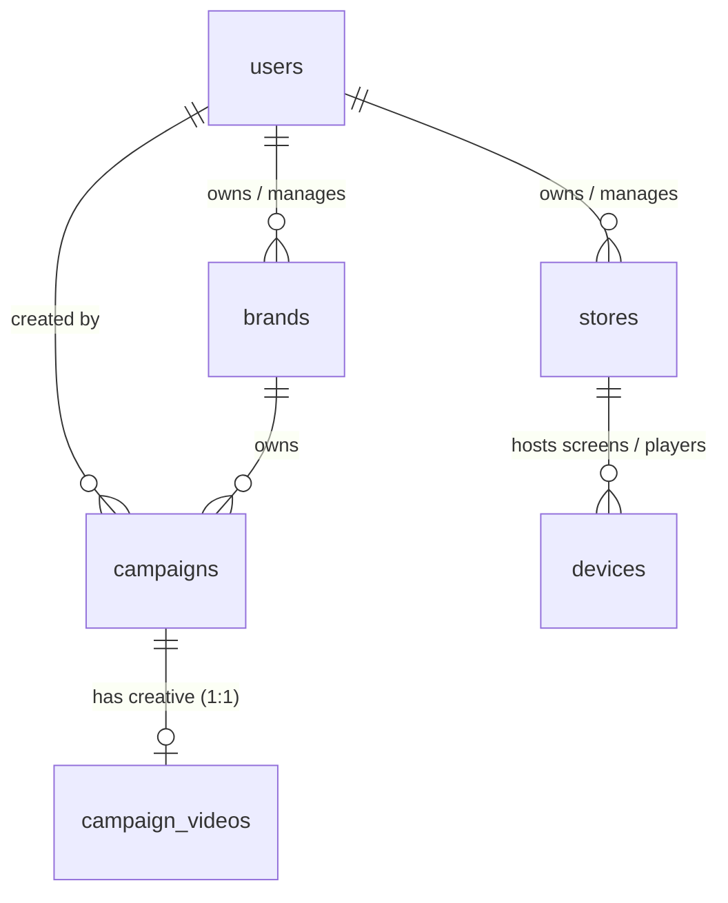

# String Theory — Project Idea & Description

## 1. Executive Summary

**String Theory** is an AI-powered, audience-matched **Digital Out-of-Home (DOOH)** advertising platform. It bridges the gap between modern consumer brands and physical venues (cafés, gyms, fashion boutiques, footwear stores) that possess digital display screens. 

Instead of dealing with opaque agencies, rigid long-term billboard contracts, or incompatible video format requirements, String Theory allows brands to:
1. Target physical spaces based on their desired audience footfall.
2. Upload a single master video creative.
3. Automatically adapt, transcode, schedule, and deploy campaigns across a network of connected venue displays with verified proof-of-play.

> **Vision**: *"Digital out of home, matched by audience. Your audience has screens waiting for you."*

---

## 2. Product Description & Problem Statement

### The Problem
- **Fragmentation in Physical Advertising**: Buying digital screen time in the physical world is archaic, manual, and dominated by high-cost highway billboards that lack audience context.
- **Wasted Impressions**: Brands advertise to generic commuter traffic rather than engaging people where they spend focused dwell time (e.g., running shoes advertised in gyms, beverage brands in artisan cafés).
- **Format Chaos**: Every venue screen has different aspect ratios, resolutions, bitrate requirements, and codec capabilities.
- **Unmonetized Venue Inventory**: Local businesses, cafés, and gyms have screens displaying static menus or ambient television without generating recurring advertising revenue.

### The String Theory Solution
String Theory turns brick-and-mortar display screens into a programmatic, highly contextual advertising network:
- **Audience-to-Venue Matching**: Rather than selecting coordinates or billboards, brands target lifestyle categories and demographics (e.g., Tech & Coffee lovers in Indiranagar, Fitness enthusiasts in Bellandur).
- **"Upload Once, Play Everywhere"**: The platform ingests a single high-quality master creative, validates it, and transcodes it to standard H.264 assets optimized for every screen in the chosen network.
- **Contextual Daypart Scheduling**: Creative displays dynamically according to venue operating rhythms (e.g., breakfast hours in cafés, evening peaks in gyms, weekends in retail).
- **Transparency & Proof-of-Play**: Granular reporting by location and display rather than aggregated guesswork.

---

## 3. Core Features & Experiences

### 3.1 Public Experience & Marketing Landing Page
- **Cinematic, Motion-First Interface**: Built with GSAP and smooth scroll interactions, avoiding generic SaaS aesthetics.
- **Venue Category Showcase**: Dynamic previews of venue types (Cafés, Gyms, Apparel, Footwear) tied to real footfall estimates across representative urban clusters (e.g., Bengaluru hotspots like Indiranagar, Koramangala, Bellandur, UB City).
- **Audience Discovery Preview**: Demonstrates how creative travels from brand upload to venue dayparting.

### 3.2 Campaign Creation & Creative Dropzone (`/campaigns/new`)
- **Self-Serve Campaign Setup**: Brands input company details, campaign flight dates (`starts_on`, `ends_on`), and campaign briefs.
- **Instant Account Bootstrap**: Unregistered users who launch a campaign automatically have brand accounts and authentication records initialized without friction.
- **Resilient Video Ingestion**: Client-side video metadata extraction with presigned upload workflows.

### 3.3 The Video Ingestion & Transcoding Pipeline
The platform implements an explicit finite state machine (FSM) for processing video creative:

```
[AWAITING_UPLOAD] ──► [UPLOADING] ──► [UPLOADED]
                                          │
                                          ▼
[READY] ◄── [ENCODING] ◄── [PROCESSING]
   │             │              │
   │      (Error │ Backoff)     │ (Error / Backoff)
   │             ▼              ▼
   └─────── [RETRYING] ──► [FAILED]
```

- **Safety Guarantee**: Original master videos are temporarily preserved in S3 raw storage and only pruned once H.264 transcoding and integrity checks are confirmed.
- **Zero Broken Playback**: A video is only marked `READY` when S3 keys, dimensions, codecs, and durations are validated.

### 3.4 Brand Dashboard (`/dashboard`)
- **Single-Pane Visibility**: View campaign lifecycle states (`DRAFT`, `IN_REVIEW`, `SCHEDULED`, `LIVE`, `PAUSED`, `COMPLETED`).
- **Creative Tracking**: Monitor transcoding status, bitrate, and upload health in real-time.
- **Google Sign-In**: Streamlined OAuth authentication for team members.

### 3.5 Operator Admin Console (`/admin`)
- **Network Governance**: Operators oversee all enrolled brands, active stores, and screen allocations.
- **Inventory Management**: Create, edit, and audit venue locations, contact details, and available screen counts.
- **Content Moderation**: Review brand creatives before scheduling onto public-facing hardware.

---

## 4. User Roles & Permission Matrix (RBAC)

The system enforces strict role-based access control across three primary actors:

| Role | Description | Core Capabilities |
| :--- | :--- | :--- |
| **`BRAND`** | Advertisers & Marketing Teams | Create campaigns, upload master creative videos, choose venue audiences, review campaign analytics, manage brand profiles. |
| **`STORE`** | Venue Hosts & Screen Owners | Register physical venue locations, declare screen counts, monitor venue status, earn revenue from displays. |
| **`ADMIN`** | String Theory Operations Team | Manage all brands, audit store screen inventories, approve/moderate campaigns, oversee video encoding pipelines. |

---

## 5. Technology Stack & Architecture

### Frontend & UI
- **Framework**: [Next.js 14](https://nextjs.org/) (App Router, Server Components, and Server Actions).
- **Language**: TypeScript (Strict mode).
- **Styling**: [Tailwind CSS](https://tailwindcss.com/) with an editorial design system (paper/ink palette, bespoke typography, and elevation layers).
- **Motion & Interactions**: [GSAP](https://greensock.com/gsap/) with `@gsap/react` featuring scrubbed parallax, tilt physics, and strict `prefers-reduced-motion` compliance.
- **Icons**: [Lucide React](https://lucide.dev/).

### Backend & API
- **Route Handlers**: Next.js Server Components and RESTful JSON endpoints.
- **Data Validation**: [Zod](https://zod.dev/) schemas enforcing runtime data invariants on both client forms and server routes.
- **Authentication**: Google OAuth 2.0 (`google_subject` verified tokens) alongside password-backed administrative console sessions.
- **Maps & Discovery**: OpenFreeMap vector integration for geographic venue exploration.

### Database & Storage
- **Database**: [PostgreSQL](https://www.postgresql.org/) with connection pooling (`pg`).
  - Strict check constraints (`CHECK`), unique indexes, and PostgreSQL enums (`user_role`, `brand_status`, `campaign_status`, `video_status`, etc.).
  - Automatic `updated_at` timestamps powered by PL/pgSQL database triggers.
  - Foreign key cascades (`ON DELETE CASCADE` for campaign assets; `ON DELETE SET NULL` for audit trails).
- **Media Storage**: AWS S3 with presigned upload URLs (segregated `st-media-raw` and `st-media-encoded` buckets).

---

## 6. Data Model Overview

The relational schema links six core entities:



- **`users`**: Identity, email validation, role (`BRAND`, `STORE`, `ADMIN`), and optional Google identity claims.
- **`brands`**: Advertiser trading records, website, primary contact info, and status (`PENDING_REVIEW`, `ACTIVE`, `SUSPENDED`).
- **`stores`**: Venue supply, physical address description, declared screen inventory count, and operational state.
- **`campaigns`**: Brand-scoped marketing campaigns with flight dates (`starts_on`, `ends_on`), status, and slug uniqueness per brand.
- **`campaign_videos`**: 1:1 creative attached to a campaign, storing S3 storage pointers, dimensions, duration, bitrate, and transcode state machine steps.
- **`devices`**: Physical Raspberry Pi player hardware, unique hardware IDs, activation codes, operational status (`PENDING`, `ACTIVATED`, `REVOKED`), and bearer access tokens.

*(Full schema definitions, check constraints, and sample data records are documented in [`docs/database_schema.md`](./database_schema.md).)*

---

## 7. Current Progress & Roadmap

### What is Live in the Codebase
- [x] High-performance landing page with interactive Bengaluru venue clusters and animations.
- [x] Self-service campaign submission workflow (`/campaigns/new`) with client-and-server validation.
- [x] Secure brand dashboard (`/dashboard`) with Google OAuth authentication.
- [x] Comprehensive operator admin console (`/admin`) for brand and venue governance.
- [x] Complete PostgreSQL database schema, migrations, and idempotent seed scripts.
- [x] AWS S3 presigned upload infrastructure scaffolding.
- [x] **Raspberry Pi Player Activation**: Hardware onboarding endpoint (`POST /api/devices/activate`) with strict camelCase payload `{ deviceId, activationCode, storeId }`, store association, PostgreSQL device persistence satisfying all `devices` table attributes, and issuance of short-lived cryptographically signed secret access tokens (`device_backend/`).
- [x] **Raspberry Pi Player Automatic Login**: Device authentication endpoint (`POST /api/devices/authenticate`) with strict camelCase payload `{ deviceId, deviceCredential }`, request header store verification (`storeId`), and issuance of 900-second (15-minute) short-lived Bearer tokens.

### Roadmap & Next Steps
- [ ] **Asynchronous Transcode Worker**: Background worker (FFmpeg / AWS MediaConvert) consuming S3 upload events and producing standardized 1080p H.264 streams.
- [ ] **Interactive OpenFreeMap Explorer**: Visual map picker enabling advertisers to draw geographic geofences and select specific venue screens.
- [ ] **Hardware Player Schedule Sync**: Content distribution endpoint (`GET /api/devices/playlist`) for Raspberry Pi players to download and cache assigned campaign creatives.
- [ ] **Telemetry & Analytics Ingestion**: Real-time playhead reporting, proof-of-play logs, and footfall heatmaps for advertisers.
